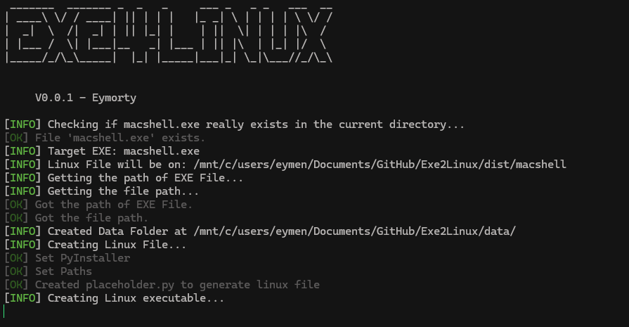

# Exe4Linux

A Python tool that wraps Windows `.exe` files for Linux using Wine.

## Features

- Converts Windows EXE files into Linux executables automatically
- Auto-detects the distribution (Arch-based → `pacman`, Debian-based → `apt`)
- Automatically installs missing dependencies (Wine, PyInstaller)
- Colorful terminal output with an animated loading indicator

## Requirements

- Python 3.x
- Wine
- PyInstaller
- Linux (an Arch-based or Debian-based distribution)

## Installation

```bash
git clone https://github.com/Eymorty/exe4linux.git
cd exe4linux
pip install -r requirements.txt
python3 main.py --exe program.exe
```

## Usage

```bash
python main.py -e game.exe
```

The `-e` / `--exe` argument specifies the target EXE file:

```bash
python main.py --exe program.exe
```

## How It Works

1. Checks that the EXE file exists
2. Checks whether Wine and PyInstaller are installed, and installs them if not
3. Copies the EXE into the `data/` folder
4. Builds a single-file Linux executable with PyInstaller
5. Writes the output to the `dist/` folder

## Output Structure

```text
exe4linux/
├── main.py              # Main entry point
├── exe4linux.py         # Core logic
├── data/                # Copied EXE file
└── dist/                # Generated Linux executable
```

## Screenshot



## Supported Distributions

| Family | Package Manager | Examples |
|--------|-----------------|----------|
| Arch | `pacman` | Arch, Manjaro, EndeavourOS, CachyOS |
| Debian | `apt` | Ubuntu, Debian, Linux Mint, Pop!_OS, Kali |


